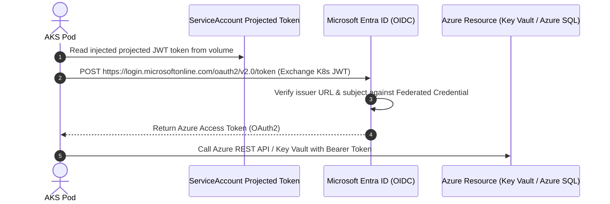

# Microsoft Azure - Azure Kubernetes Service (AKS) Master Guide

Azure Kubernetes Service (AKS) is Microsoft Azure's managed Kubernetes platform, deeply integrated with Microsoft Entra ID (formerly Azure AD), Azure Virtual Networks, and enterprise security frameworks.

---

## 1. AKS Architecture & Networking Models

### Networking CNI Comparison

| Architecture Feature | Azure CNI (Flat VNet) | Azure CNI Overlay | Azure CNI Powered by Cilium |
| :--- | :--- | :--- | :--- |
| **IP Consumption** | Every Pod consumes a real private IP from your Azure VNet subnet | Pods get overlay private IPs (`10.244.0.0/16`); Nodes get VNet IPs | Pods get overlay IPs; eBPF handles high-performance data plane |
| **VNet IP Exhaustion** | High risk; requires massive subnets (e.g., /20 or /18) | Zero risk of VNet exhaustion; scalable to 250,000 pods | Zero risk; superior throughput, latency, and observability |
| **Network Policy Engine** | Azure Network Policies or Calico | Calico or Cilium | Native eBPF Cilium (high performance, no iptables) |
| **Pod Direct VNet Routability**| Directly accessible from on-prem or peer VNets without NAT | Pods use SNAT to Node IP when reaching external VNet resources | Pods use SNAT to Node IP or direct routing |
| **Production Recommendation** | Legacy enterprise compliance only | Standard microservices | **Modern Best Practice for AKS (eBPF)** |

---

## 2. Ingress & Traffic Management

### Application Gateway Ingress Controller (AGIC)
- Directly provisions Azure Application Gateway (L7 Layer) based on Kubernetes `Ingress` resources.
- **Key Features**:
  - Integrated Azure Web Application Firewall (WAF v2) with OWASP Top 10 rules.
  - End-to-end SSL/TLS termination with certificates stored in Azure Key Vault.
  - Cookie-based session affinity and URL path-based routing.
  - Direct Pod IP routing without `NodePort` or `Kube-Proxy` hop.

### Managed NGINX / Application Routing Add-on
- In-cluster ingress controller fully managed by Microsoft.
- Integrated automated certificate issuance via Azure DNS and Let's Encrypt / Azure Key Vault.

---

## 3. Microsoft Entra Workload ID (Federated Credentials)

Microsoft Entra Workload ID replaces the legacy Pod Identity (NMI/MIC) architecture with native OpenID Connect (OIDC) federation:

### Setup Steps:
1. Enable OIDC Issuer and Workload Identity on AKS:
   `az aks update --enable-oidc-issuer --enable-workload-identity`
2. Create Microsoft Entra Managed Identity (User-Assigned).
3. Establish Federated Identity Credential linking Entra ID to `system:serviceaccount:<namespace>:<ksa-name>`.
4. Annotate K8s ServiceAccount with `azure.workload.identity/client-id: <CLIENT_ID>`.

---

## 4. Azure Storage Ecosystem

| Storage Driver | CSI Driver | Access Mode | Performance Tiers | Use Cases |
| :--- | :--- | :--- | :--- | :--- |
| **Azure Managed Disks** | `disk.csi.azure.com` | `ReadWriteOnce` | Standard HDD, Standard SSD, Premium SSD v2, Ultra Disk | Databases (MSSQL, PostgreSQL), Redis, Kafka |
| **Azure Files** | `file.csi.azure.com` | `ReadWriteMany` | Standard (SMB), Premium (NFS v4.1 / SMB) | Shared content stores, CMS assets, legacy file shares |
| **Azure Blob Storage** | `blob.csi.azure.com` | `ReadWriteMany` | Hot, Cool, Archive | Big data pipelines, AI/ML dataset ingestion, log archiving |

---

## 5. Azure Key Vault Provider for Secrets Store CSI

Avoid storing unencrypted secrets in Kubernetes etcd:
- Mounts secrets, keys, and certificates from Azure Key Vault directly as files into the Pod's volume mount.
- Automatically syncs mounted secrets into native Kubernetes `v1/Secret` objects when needed.
- Supports automatic secret rotation polling (`enable-secret-rotation: "true"`).

---

## 6. AKS Production Manifests Catalog

1. **`01-agic-ingress.yaml`**: Azure Application Gateway Ingress with WAF annotations, SSL termination, and cookie affinity.
2. **`02-entra-workload-id.yaml`**: Microsoft Entra Workload ID federated ServiceAccount and deployment accessing Azure Key Vault.
3. **`03-azure-disk-storageclass.yaml`**: Premium SSD v2 Managed Disk StorageClass with zone-redundant storage (Premium_ZRS) and volume expansion.
4. **`04-azure-files-rwx.yaml`**: Azure Files NFS v4.1 StorageClass and ReadWriteMany PVC for cross-pod shared persistent storage.
5. **`05-keyvault-secretprovider.yaml`**: Secrets Store CSI Driver SecretProviderClass syncing Azure Key Vault secrets into native Kubernetes Secrets.\n