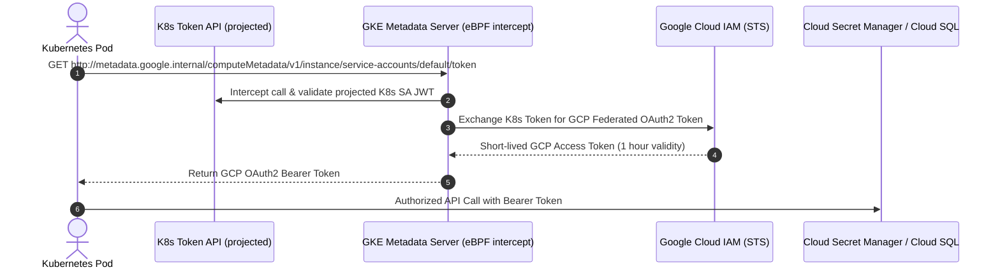

# Google Cloud Platform (GCP) - Google Kubernetes Engine (GKE) Master Guide

Google Kubernetes Engine (GKE) is Google Cloud's managed Kubernetes service, widely recognized for its deep native Kubernetes engineering, fast node provisioning, and advanced networking with Datapath v2.

---

## 1. GKE Architecture: Autopilot vs. Standard

| Architectural Feature | GKE Autopilot | GKE Standard |
| :--- | :--- | :--- |
| **Node Management** | Fully Google-managed; nodes are provisioned, scaled, repaired, and updated automatically | Customer manages node pools, OS images, SSH access, sysctl tuning, daemonsets |
| **Billing Model** | Pay per requested vCPU, memory, and ephemeral storage for scheduled Pods | Pay per underlying Compute Engine VM instances and persistent disks |
| **Security Hardening** | Hardened baseline enforced (no privileged containers, restricted capabilities, Shielded Nodes) | Full root/privileged access supported, custom security policies configurable |
| **SLA & Uptime** | 99.95% multi-zonal SLA for pods and 99.9% for control plane included | 99.95% multi-zonal control plane SLA (with paid cluster management fee) |
| **Recommended For** | General microservices, web apps, standard enterprise applications | Custom kernel modules, specialized networking (SR-IOV), legacy privileged daemons |

---

## 2. Advanced Networking: Datapath v2 & Gateway API

### Datapath v2 (eBPF Engine)
- GKE Datapath v2 replaces traditional `kube-proxy` iptables with **Cilium-powered eBPF** directly in the Linux kernel.
- **Benefits**:
  - Linear performance scaling without iptables rule bloat (even with 10,000+ services).
  - Native Kubernetes `NetworkPolicy` enforcement without extra CNI agents.
  - Direct Pod-to-Pod routing visibility and flow logging via Google Cloud Network Topology.

### GKE Gateway Controller
GKE implements the Kubernetes **Gateway API** as a first-class citizen, replacing legacy Ingress controllers with Google Cloud HTTP(S) Load Balancers:
- `gke-l7-global-external-managed`: Global external Application Load Balancer with Anycast IP, Cloud CDN, and Google Cloud Armor WAF.
- `gke-l7-rilb`: Regional internal Application Load Balancer for private microservices communication.
- Role-oriented configuration: Cluster operators manage `Gateway` (listeners, TLS, IP), while app developers manage `HTTPRoute` (path routing, header rewrites, mirrors).

---

## 3. Workload Identity Federation

Workload Identity is the Google Cloud standard for authenticating Kubernetes Pods to GCP APIs without long-lived service account keys:

### Key Configuration Steps:
1. Enable Workload Identity on GKE cluster (`--workload-pool=PROJECT_ID.svc.id.goog`).
2. Annotate the Kubernetes ServiceAccount:
   `iam.gke.io/gcp-service-account: GSA_NAME@PROJECT_ID.iam.gserviceaccount.com`
3. Grant IAM roles on GCP Service Account to Kubernetes identity:
   `roles/iam.workloadIdentityUser` for `serviceAccount:PROJECT_ID.svc.id.goog[NAMESPACE/KSA_NAME]`.

---

## 4. GKE Storage Portfolio

| Storage Type | Driver / Provisioner | Access Mode | Replication / Durability | Target Workloads |
| :--- | :--- | :--- | :--- | :--- |
| **GCE Persistent Disk (PD)** | `pd.csi.storage.gke.io` | `ReadWriteOnce` | Zonal or Regional (replicated across 2 zones) | Relational DBs (PostgreSQL, MySQL), Kafka, Redis |
| **Filestore (NFS)** | `filestore.csi.storage.gke.io` | `ReadWriteMany` | Managed NFS cluster with automatic snapshots | CMS (WordPress), shared ML models, media processing |
| **Cloud Storage FUSE** | `gcsfuse.csi.storage.gke.io` | `ReadWriteMany` | Globally distributed object storage | Large AI/ML training datasets, model weights checkpoints |

---

## 5. Google Cloud Config Connector (KRM)

Config Connector is an open-source Kubernetes addon from Google that allows you to manage GCP infrastructure declaratively using Kubernetes manifests (Kubernetes Resource Model - KRM):
- Manage Cloud SQL instances, BigQuery datasets, Cloud Pub/Sub topics, and Cloud Storage buckets directly via `kubectl`.
- Automatically inherits Kubernetes GitOps workflows (ArgoCD, Flux).
- Reconciles drift continuously against the GCP Control Plane.

---

## 6. GKE Production Manifests Catalog

1. **`01-gke-gateway-api.yaml`**: GKE Global External Application Load Balancer Gateway with HTTPRoute, Cloud Armor WAF integration, and SSL policy.
2. **`02-workload-identity.yaml`**: Complete Workload Identity binding manifest with secure service account and sample workload querying GCP Secret Manager.
3. **`03-gce-pd-storageclass.yaml`**: High-availability Regional Balanced Persistent Disk with 2-zone synchronous replication and volume snapshots.
4. **`04-filestore-rwx-storage.yaml`**: Filestore CSI StorageClass and dynamic ReadWriteMany volume claim for enterprise shared storage.
5. **`05-config-connector.yaml`**: Declarative GCP Cloud SQL PostgreSQL instance and Cloud Storage bucket provisioned via Kubernetes CRDs.\n